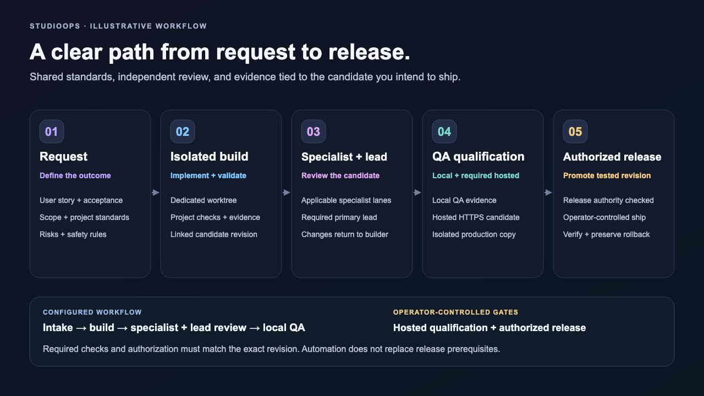
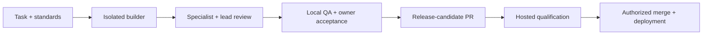
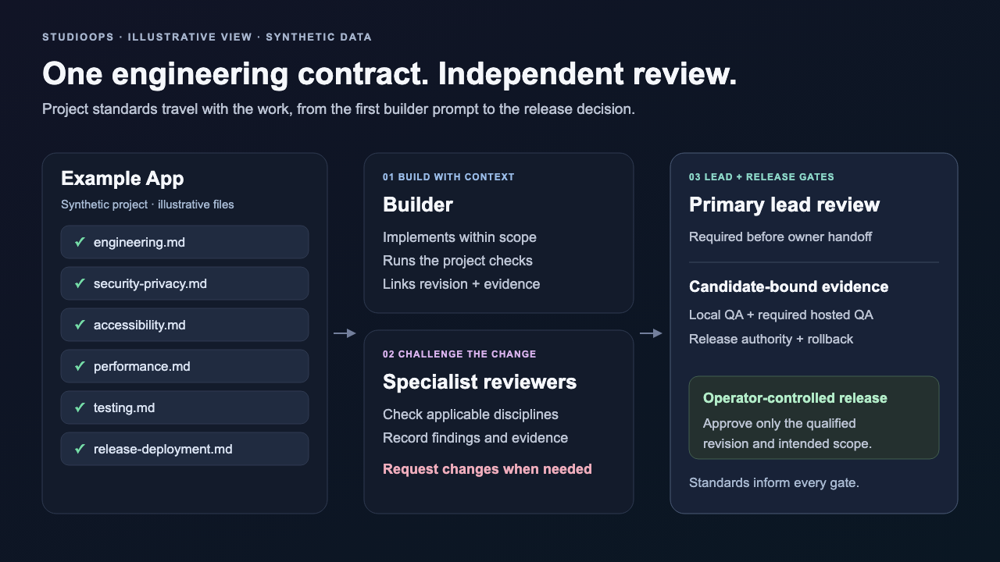
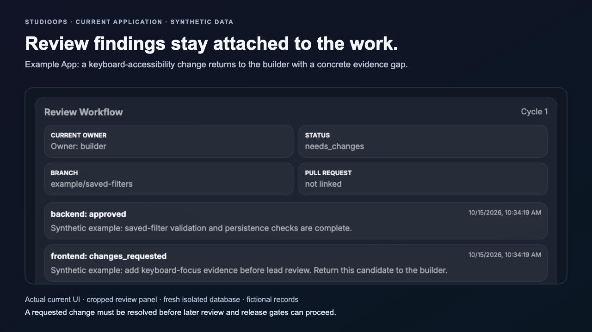

# StudioOps

<p align="center">
  
</p>

StudioOps coordinates AI-assisted software delivery through structured tasks, isolated builders, specialist and lead reviews, and a local QA board. It records who owns the next step and keeps production releases under human control.

> **Developer preview:** a local, single-owner control plane. It is not an enterprise multi-user service. Review [limitations](#current-limitations) and [sharing guidance](docs/SHARING.md) before evaluating it with a team.



## What works today

- Structured projects, epics and tasks with acceptance criteria, dependencies, standards and privacy notes.
- Isolated Git workspaces for builders and applicable backend, frontend, accessibility, regression and lead reviewers.
- Durable task history, run results, candidate identities, review evidence and an **Action required** owner inbox.
- Transactional SQLite state with short compare-and-swap writes; unchanged routine sweeps do not advance the state version.
- Configured model and usage policies, bounded failure recovery, operator pauses and stale-worker detection.
- Commit-bound component mapping and structural context retrieval. Retrieved context is advisory and does not expand task scope or release authority.
- Optional local QA assembly and preview refresh for lead-approved work.
- Release-candidate PR preparation after owner QA, without directly pushing the protected branch.

## Workflow and UML



[UML activity and component diagrams](docs/workflow-uml/README.md) describe the implemented workflow and its boundaries. Editable PlantUML sources and rendered images are included. The mapping also explains where an issue tracker such as Jira could connect; a Jira adapter is a proposal, not a shipped integration.

Local QA and a prepared PR are intermediate outcomes. Production requires the project's [hosted release-candidate checks](standards/hosted-release-candidate-qa.md), exact revision identity, review approval, recorded release authorization and rollback safeguards. Hosted environment setup and production deployment remain operator-controlled; this release does not automate that entire process.

Workers share durable task, review and repository-context records. They have separate model sessions, not a shared consciousness or instant knowledge of every other worker's context.

## Review evidence matters

A passing backend review does not replace frontend, accessibility, security or QA evidence. Material findings return work to the builder; lead review checks that the required evidence is complete.



The following visual uses synthetic demonstration data. It does not expose a live project's tasks, reviews or deployment history.



## Quick start

Requirements: Node.js `22.5` or newer, npm and Git. Worker execution also needs a configured Codex provider; GitHub automation needs repository access and GitHub App credentials. The included background-service installer uses macOS LaunchAgents.

```bash
mkdir -p "$HOME/.codex/workspaces"
git clone https://github.com/magic2goodil/studioops.git "$HOME/.codex/workspaces/studioops"
cd "$HOME/.codex/workspaces/studioops"
npm ci
npm run setup
npm run dev
```

Open [the local board](http://127.0.0.1:4317). Setup writes local configuration and can register a first project. It does not ask you to paste private keys. See [Getting Started](docs/GETTING_STARTED.md) for configuration, first-task intake and operating modes.

## Codex plugin

The repository is also a local Codex plugin marketplace:

```bash
codex plugin marketplace add "$HOME/.codex/workspaces/studioops"
codex plugin add studioops@studioops-marketplace
```

Start a new Codex task after installation or an update. Then ask:

```text
Set up StudioOps for this project using safe local defaults.
```

The `setup-studioops` skill installs and verifies the local control plane. The `run-studioops` skill creates or reuses the matching project and records structured work. For example:

```text
Create a StudioOps task for this feature, with acceptance criteria and validation.
Do not start a builder yet. Send me the task link and next owner.
```

See [Plugin guide](docs/PLUGIN.md) for development, packaging and updates. The plugin is skills-first; it does not include credentials, a hosted account or an MCP server.

## Operation and usage

Preview dispatch and runner work before enabling it:

```bash
npm run supervisor
npm run dispatcher -- --plan
npm run runner -- --plan
```

`npm run automation-tick -- --limit 50` writes workflow-routing state. It is not a dry run. Enabling workers can consume the configured provider's usage; MIT licensing does not make model use free. Preserve operator pauses and quota controls, keep one accountable implementation owner, and avoid retrying unchanged failures.

For macOS always-on operation:

```bash
npm run install-agents
npm run status-agents
```

The installer publishes an immutable runtime under `~/.codex/studioops/runtime` and keeps source and operational state under `~/.codex/studioops`. See [Local Automation](docs/LOCAL_AUTOMATION.md) before enabling services. Planned hosted/team services are described separately in [Product Tiers](docs/PRODUCT_TIERS.md); they are not implied by this local release.

## GitHub identities

Use an explicitly configured GitHub App for automated Git writes and reviews:

```bash
npm run setup-github-app -- --owner YOUR_GITHUB_USER
# Or separate role identities:
npm run setup-github-role-apps -- --owner YOUR_GITHUB_USER
```

Use `--org --owner YOUR_ORGANIZATION` for an organization registration. Required App authentication fails closed instead of silently falling back to a personal account. See [GitHub App Bots](docs/GITHUB_APP_BOTS.md).

## State and backups

The default database is `~/.codex/studioops/control-plane/data/mission-control.sqlite3`. SQLite WAL and short transactions protect concurrent writes. Legacy `MISSION_CONTROL_*` environment variables remain supported. Local configuration, databases, credentials, backups, attachments and run output belong outside Git.

Create a consistent backup with `npm run backup`. Review the configured destination before sharing files; an operational backup is private data, not an installation package.

## Current limitations

- Single-owner local operation; the web UI has no internet-facing multi-user authentication. Keep it bound to loopback unless a separately secured deployment has been reviewed.
- The packaged background services and desktop notifications use macOS.
- Configured builders can execute commands, edit code, push branches and open PRs. Review project standards and integration permissions before enabling them.
- Hosted release qualification and production deployment require operator work and project-specific safeguards. A local preview is not a substitute.
- Jira intake and enterprise identity, network and data controls require integration work and organizational approval.
- Cloud coding providers may receive prompts and repository context even when the board and repositories are local. Use approved accounts and synthetic or minimized data.

## Documentation and sharing

- [Sharing and evaluation](docs/SHARING.md): clean snapshots, package contents and Git-history limits
- [Workflow UML](docs/workflow-uml/README.md): activity/component diagrams and implementation mapping
- [Architecture](docs/ARCHITECTURE.md): components, persistence and trust boundaries
- [Codex Workflow](docs/CODEX_WORKFLOW.md) and [Review Pipeline](docs/REVIEW_PIPELINE.md): intake through candidate preparation
- [Future Chat Handoff](docs/HANDOFF.md): task and acceptance standards
- [Runner](docs/RUNNER.md): providers, workspaces and failure recovery
- [Project Standards](standards/README.md): engineering, accessibility, privacy and release defaults
- [Privacy](PRIVACY.md), [Terms](TERMS.md), [Support](SUPPORT.md) and [Security](SECURITY.md)

Contributions are welcome; read [CONTRIBUTING.md](CONTRIBUTING.md). Report security issues privately using the security policy.

[MIT license](LICENSE)
