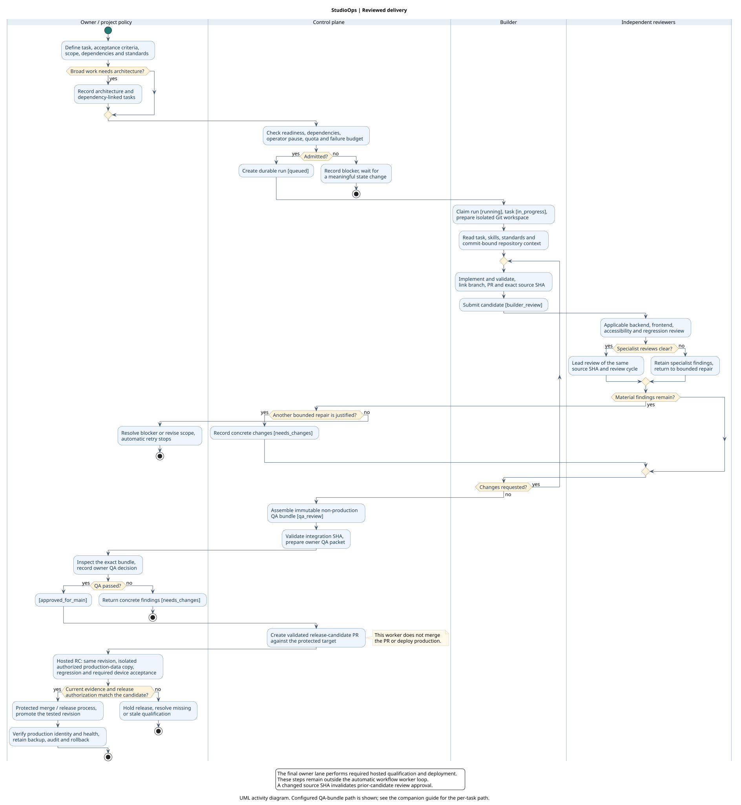
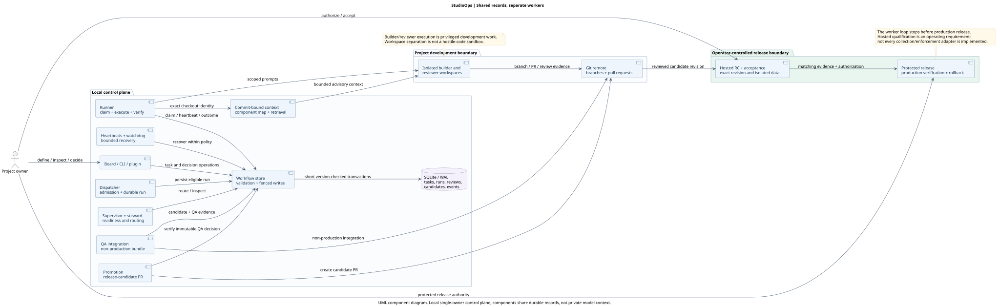

# StudioOps workflow in UML

StudioOps turns a defined task into reviewed, traceable engineering work. A control plane coordinates independent builders and reviewers using durable task, run, candidate and evidence records. The project owner controls acceptance and production release.

These diagrams describe the implementation at `07b07b78225652b13e50a32982b39f231bd5aac2`. They use UML activity partitions and UML components, with editable PlantUML sources. The diagrams are intentionally generic and contain no real project tasks, customer records, employer references or screenshots of operational state.

## Delivery responsibilities



[Editable activity source](studioops-activity.puml) · [PNG](studioops-activity.png)

The activity diagram follows the configured QA-bundle path. When Trust Leads is disabled, reviewed work instead reaches per-task `user_review`. That choice changes the owner's inspection unit, not production authority. Broad tasks can first require an architect to record decisions and dependency-linked child tasks.

Review evidence is bound to the complete source commit and review cycle. A changed candidate cannot inherit earlier approvals automatically. A failed attempt needs concrete new evidence or a changed input before retry; a stopped or blocked run is not a delivered result.

Hosted release-candidate testing is an operator requirement for applicable deployments. It includes a controlled HTTPS environment, verified isolated production-data copy, migration rehearsal, regression and required normal-authentication/device acceptance. The public workflow workers do not provide a complete hosted collection and activation system. Local preview success alone is not production qualification.

After QA, promotion creates a release-candidate PR. It does not push directly to the protected target or deploy production. The authorized release process promotes the tested revision, verifies production identity and health, and preserves rollback. RC data and test history never replace production data.

## Coordination, not shared model memory



[Editable component source](studioops-components.puml) · [PNG](studioops-components.png)

Workers share task/run history, review findings, source identities and bounded repository context through the control plane. Each model invocation still has its own context. A record being available for retrieval does not mean every worker has read it. Commit-bound indexing improves targeted retrieval without granting broader editing or release authority.

The existing product is a local single-owner control plane. Workspace isolation and validation safeguards do not make privileged coding agents safe to run arbitrary hostile code. Internet-facing authentication, enterprise multi-user governance and a Jira connector must not be inferred from this diagram.

## Mapping a general issue-tracker workflow

| Workflow idea | Current StudioOps mechanism | Boundary |
| --- | --- | --- |
| Prioritize and define work | Task story, outcome, acceptance, priority, scope and dependencies | Impact/effort formulas are project policy, not an automatic business decision. |
| Ready for development | `ready`, then admitted `queued` run and claimed `in_progress` work | Pause, quota, ownership and failure controls can prevent dispatch. |
| Application-specific worker | Registered project, scoped repository, role and standards | One accountable owner; parallel work must respect scope and dependency conflicts. |
| Read skills and standards | Builder/reviewer prompt and repository context | Retrieved context is advisory; repository code and issue text are not higher-authority instructions. |
| Branch, environment and implementation | Isolated workspace, task branch, validation and PR handoff | Environment and data permissions remain project-specific. |
| Repository-appropriate reviews | Backend, frontend, accessibility, regression and lead lanes | Explicit skips need a reason; lead approval does not replace owner acceptance. |
| Ask questions / request changes | Durable comments, blocked state and `needs_changes` | Stop when unchanged blockers or retry limits remain. |
| UAT and deployment | Owner QA decision, candidate PR, separate authorized release process | Hosted QA and required human/device acceptance must bind to the tested candidate. |
| Jira owns the business ticket | Not implemented in this current integration | An adapter would need authenticated intake, deduplication, permissions and status reconciliation. |

## Source references

The map and structural context retrieval were checked at the revision above. Retrieval succeeded with partial coverage; relevant workflow sources were then read directly.

- `src/lifecycle-policy.js`, `src/store.js`, `src/state-database.js`: state and evidence ownership.
- `src/dispatcher.js`, `src/runner.js`, `src/mission-control-context.js`: admission, execution and commit-bound context.
- `src/qa-integration.js`, `src/promotion.js`: non-production composition and candidate PR creation.
- `docs/ARCHITECTURE.md`, `docs/REVIEW_PIPELINE.md`, `docs/architecture/components.json`: component and review contracts.

The diagrams use the current candidate-PR implementation and explicitly separate the operator's hosted-release requirement from implemented worker capabilities.

## Rendering

Use a local [PlantUML renderer](https://plantuml.com/download); do not send private diagram source to a public rendering service. The source uses [UML activity syntax](https://plantuml.com/activity-diagram-beta) and standard component notation. Render with embedded editable source disabled. Generator or version attribution may still remain:

```sh
java -Djava.awt.headless=true -jar /path/to/plantuml.jar -nometadata -tsvg studioops-*.puml
java -Djava.awt.headless=true -jar /path/to/plantuml.jar -nometadata -tpng studioops-*.puml
```
